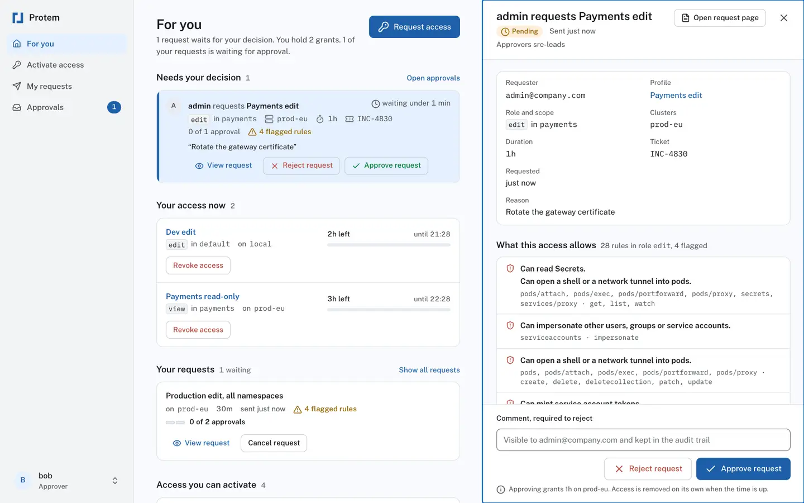
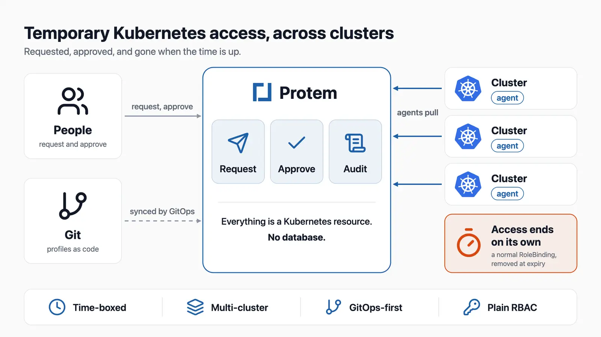
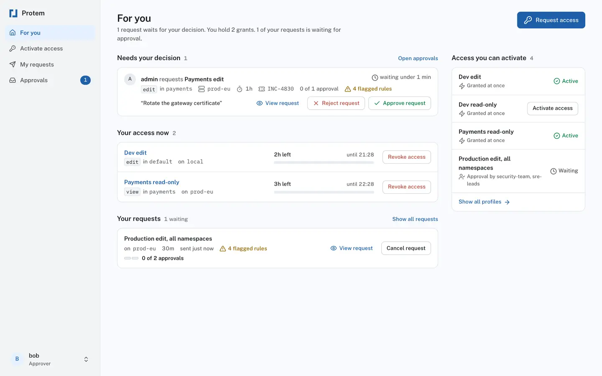
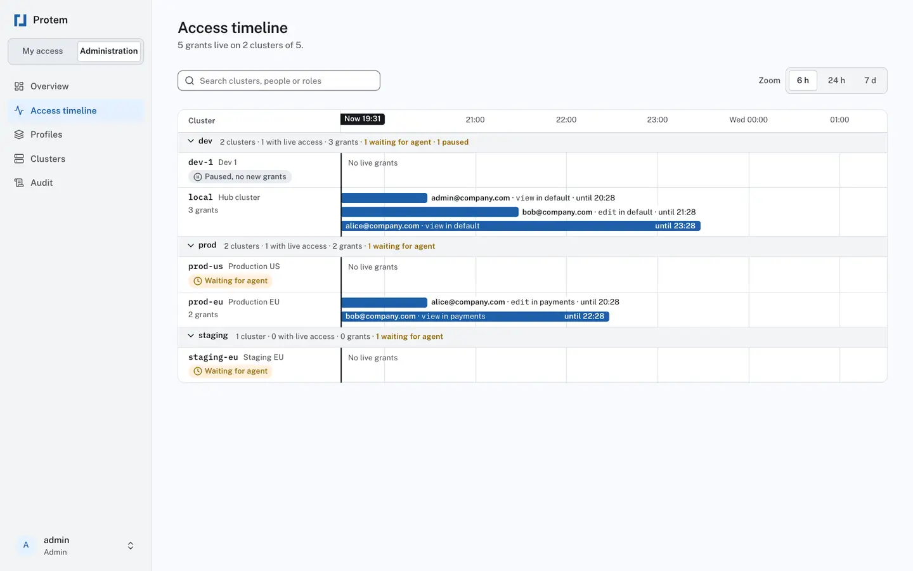
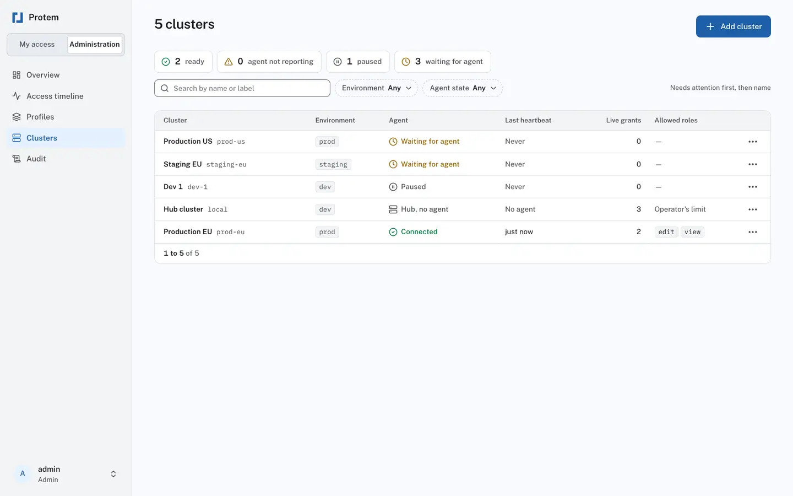
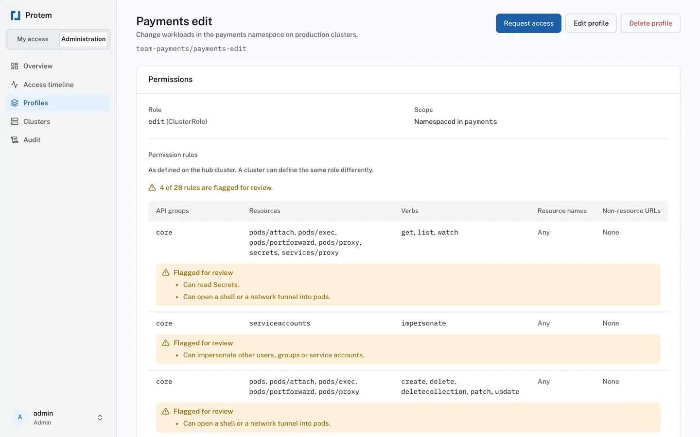

<div align="center">
  <picture>
    <source media="(prefers-color-scheme: dark)" srcset="brand/logo/protem-horizontal-on-dark.svg">
    
  </picture>
  <p>
    <a href="https://github.com/iLLeniumStudios/protem/actions/workflows/test.yml"></a>
    <a href="https://github.com/iLLeniumStudios/protem/actions/workflows/lint.yml"></a>
    <a href="https://github.com/iLLeniumStudios/protem/releases"></a>
    <a href="LICENSE"></a>
  </p>
</div>

# Protem

**Protem** is just-in-time privileged access management for Kubernetes. It replaces standing admin rights with time-bound, approval-gated access across a fleet of clusters: engineers request a role, approvers see exactly what it grants, and every grant is audited and revoked automatically when it expires.

<div align="center">
  <picture>
    <source media="(prefers-color-scheme: dark)" srcset="docs/guides/images/request-approval-dark.png">
    
  </picture>
</div>

<p align="center">
  <a href="#getting-started"><b>Getting started</b></a> ·
  <a href="#core-concepts"><b>Core concepts</b></a> ·
  <a href="#architecture"><b>Architecture</b></a> ·
  <a href="#install"><b>Install</b></a> ·
  <a href="#get-involved"><b>Get involved</b></a>
</p>

## Getting started

- [Your first request](docs/getting-started/first-request.md): from an empty cluster to a granted request you watch expire
- [What Protem is](docs/overview.md) and [the concepts behind it](docs/architecture/concepts.md)
- [Install with Helm](docs/guides/how-to-install-with-helm.md) or [with OLM](docs/guides/how-to-install-with-olm.md)

To try it in two minutes against any cluster you are admin on (kind and k3d work), run the operator on your machine with its built-in test users. This is for trying it out only: there is no login. It needs Go 1.26+ and `kubectl`.

```sh
git clone https://github.com/iLLeniumStudios/protem.git
cd protem
make install                                  # the custom resource definitions
kubectl apply -f hack/dev-personas-rbac.yaml  # makes the test admin a hub admin
kubectl apply -k config/samples               # two profiles, the hub as a cluster, one request
go run ./cmd/main.go --dev-auth --api-bind-address=127.0.0.1:8080
```

The sample request is self-service, so it is granted at once:

```console
$ kubectl get accessrequests,accessgrants
NAME                                      PROFILE    REQUESTER           PHASE      DURATION   GRANT
accessrequest.protem.dev/alice-dev-view   dev-view   alice@company.com   Approved   30m0s      grant-alice-dev-view

NAME                                          PROFILE    REQUESTER           ROLE   PHASE    EXPIRES AT
accessgrant.protem.dev/grant-alice-dev-view   dev-view   alice@company.com   view   Active   2026-11-24T21:03:00Z

$ kubectl auth can-i list pods -n default --as alice@company.com
yes
```

Open <http://127.0.0.1:8080> and switch between the requester, approver and admin test users from the account menu at the bottom left.

## Core concepts

Everything is a Kubernetes resource on the hub cluster.

- **Profile** (`AccessProfile`): something people can ask for. It names a role, where it applies, the clusters it covers, who may request it, for how long, and which approval rule applies on each cluster. Profiles are meant to live in Git.
- **Request** (`AccessRequest`): one person asking for one profile, with a reason. It records the role, scope and clusters at the moment it is created, so a later change to the profile cannot change what an approver agreed to.
- **Approval rule**: part of a profile. Each cluster gets the first rule that matches it: granted at once, or after a number of named people or groups approve.
- **Grant** (`AccessGrant`): approved access with an end time. The operator creates it; nobody writes one by hand.
- **Target cluster** (`TargetCluster`): a cluster Protem grants access on. The hub itself can be one.
- **Agent**: a small program on each target cluster. It reads the grants for its own cluster from the hub, creates the `RoleBinding`s, and removes them when they end.

Each one is explained with a real manifest in [the concepts guide](docs/architecture/concepts.md).

## Core principles

- **Access ends on its own.** Every grant has an end time. The target cluster enforces it, so access still expires while the hub is unreachable.
- **No stored admin credentials.** Each agent pulls its own grants from the hub. The hub holds no credentials for the clusters it serves.
- **Git first.** Who may request which role, on which clusters, and who approves are resources you keep in Git. The UI steps back for anything Argo CD, Flux or Helm manages.
- **Approvers see what they approve.** A request shows the role's actual rules, with the risky ones (reading Secrets, opening a shell in pods) listed first.
- **The cluster owner sets the limit.** An agent can bind only the roles its own cluster allows, whatever the hub asks for.
- **Plain RBAC.** No authorization webhook and no API server flags, so it does not depend on control-plane access.

Protem is not a replacement for everyday RBAC, and it does not broker or record `kubectl` sessions. Use it for the exceptions: incident response and rare elevated tasks.

## Architecture

<div align="center">
  <picture>
    <source media="(prefers-color-scheme: dark)" srcset="docs/architecture/images/poster-dark.png">
    
  </picture>
</div>

- **Operator**: runs on the hub. It checks each request against its profile, records approvals, creates grants, and writes one `ClusterGrant` per target cluster into that cluster's own namespace on the hub.
- **Web UI and API**: served by the operator. People request, approve and revoke here; administrators see clusters, profiles, an access timeline and the audit trail.
- **Agent**: one per target cluster. It can read only its own namespace on the hub, binds only the roles its cluster allows, and deletes each binding at its end time on a local timer.
- **Kubernetes resources**: the only store. There is no database; the audit trail is written as log lines.

More in [how it works](docs/architecture/how-it-works.md) and [the security model](docs/architecture/security-model.md), which says what each party can and cannot do.

## Screenshots

| | |
|---|---|
| **For you:** what needs your decision, your access and what you can activate<br><picture><source media="(prefers-color-scheme: dark)" srcset="docs/guides/images/for-you-dark.png"></picture> | **Access timeline:** who has access to which cluster, and until when<br><picture><source media="(prefers-color-scheme: dark)" srcset="docs/guides/images/access-timeline-dark.png"></picture> |
| **Clusters:** agent state and the roles each cluster's owner allows<br><picture><source media="(prefers-color-scheme: dark)" srcset="docs/guides/images/clusters-dark.png"></picture> | **Profile:** the role's rules, with the risky ones flagged<br><picture><source media="(prefers-color-scheme: dark)" srcset="docs/guides/images/profile-permissions-dark.png"></picture> |

## Install

The hub needs Kubernetes 1.30 or later. Images and the chart are published to `ghcr.io/illeniumstudios` for each release; replace `<version>` with one from the [releases page](https://github.com/iLLeniumStudios/protem/releases), without the leading `v`.

```sh
helm install protem oci://ghcr.io/illeniumstudios/charts/protem \
  --version <version> --namespace protem-system --create-namespace
```

Then two things make it usable:

- **Login:** [put a single sign-on proxy in front of the UI](docs/guides/how-to-set-up-login.md).
- **Clusters:** [connect each target cluster](docs/guides/how-to-connect-a-target-cluster.md).

Other ways in: [with OLM](docs/guides/how-to-install-with-olm.md), or from a checkout with `make deploy IMG=<your image>` for development. Settings are in the generated reference for the [chart values](docs/reference/chart-values.md), the [operator flags](docs/reference/operator-flags.md) and the [custom resources](docs/reference/custom-resources.md).

## Documentation

- [Overview](docs/overview.md) and [concepts](docs/architecture/concepts.md)
- [Guides](docs/guides): one page per task, from requesting access to writing a profile
- [Reference](docs/reference): custom resources, flags and chart values, generated from the code
- [Architecture](docs/architecture) and the [decisions](docs/adr) behind it
- [Operations](docs/operations): the audit log, metrics and what to do when something is wrong
- [GLOSSARY.md](GLOSSARY.md): the terms used across the code, the UI and the docs

## Get involved

- [Report a bug or ask a question](https://github.com/iLLeniumStudios/protem/issues)
- [Send a pull request](docs/contributing/getting-started/first-change.md); for anything larger than a fix, open an issue first so the approach can be agreed before the work
- [Report a security problem privately](SECURITY.md), not in a public issue

### Local development

```sh
make test   # unit tests and tests against a real API server (envtest)
make lint   # golangci-lint
```

The UI is in `web/` (React, built with Bun) and is embedded into the operator from `web/dist`, which is committed. [Your first change](docs/contributing/getting-started/first-change.md) covers the rest, including the files that are generated.

## License

[Apache License 2.0](LICENSE)
