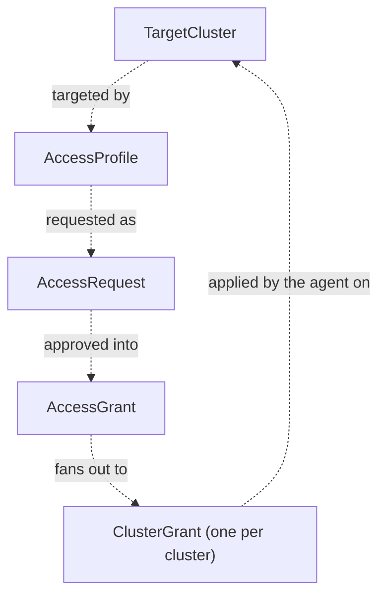

# Concepts

The five resources Protem adds, in the order a person meets them, and how they relate.

Three ideas to hold before the resources themselves: there is one hub cluster and any number of target clusters, each running an agent; a request's approval rule is chosen per target cluster, and the first rule in the profile that matches a cluster wins; and access always ends on the target cluster itself, on the agent's own timer, whether or not the hub is reachable at that moment.



## TargetCluster

A cluster Protem can grant access on: the hub itself, or another cluster running an agent. Created by a person (or the UI, which does the same thing), once per cluster.

```yaml
apiVersion: protem.dev/v1alpha1
kind: TargetCluster
metadata:
  name: local
  labels:
    env: dev
spec:
  displayName: Hub cluster
```

`metadata.name` is the cluster's identifier everywhere else (an `AccessProfile`'s `clusters.names`, an `AccessRequest`'s `clusters`) and cannot be changed later. `spec.displayName` is what the UI shows instead. Labels like `env: dev` let a profile's `clusters.selector` target clusters by label rather than by name. The rest of the fields — `spec.paused`, `spec.subject`, `spec.enforcement` — and the full status are in [the generated reference](../reference/custom-resources.md).

## AccessProfile

What can be requested: a role, on which clusters and namespaces, by whom, for how long, and under which approval rules. Normally kept in Git. Created by whoever administers access — a person applying a manifest, or the UI when `--ui-management=enabled`.

```yaml
apiVersion: protem.dev/v1alpha1
kind: AccessProfile
metadata:
  name: read-default
  namespace: default
spec:
  displayName: Read the default namespace
  role:
    kind: ClusterRole
    name: view
  scope: Namespaced
  namespaces: [default]
  clusters:
    names: [local]
  duration:
    default: 1h
    max: 4h
  requesters:
    groups: [devs]
  justification:
    reason: Required
  approval:
    rules:
    - name: self-service
      mode: Auto
```

`spec.role` and `spec.scope` are what gets bound — a `ClusterRole` or `Role`, cluster-wide or namespaced. `spec.requesters` says who may ask: by group, by user, or both. `spec.approval.rules` is an ordered list; the first rule whose `when` matches a resolved cluster decides whether that cluster needs approval (`mode: Manual`, with `approvers` and `requiredApprovals`) or none (`mode: Auto`). Every other field — justification, per-rule `maxDuration`, `allowSelfApproval` — is in [the generated reference](../reference/custom-resources.md).

## AccessRequest

One person's ask for one profile's elevation. Created by the UI (which fills in the requester from the login) or directly with `kubectl` (then the requester must be the caller, unless the admission policy's `delegate` exemption applies — see [how to enforce requester identity for kubectl requests](../guides/how-to-enforce-requester-identity-for-kubectl-requests.md)).

```yaml
apiVersion: protem.dev/v1alpha1
kind: AccessRequest
metadata:
  name: alice-read-default
  namespace: default
spec:
  profileRef: read-default
  requester:
    username: alice
    email: alice@company.com
    groups: [devs]
  clusters: [local]
  duration: 30m
  justification:
    reason: Checking a failing rollout.
```

`spec` is immutable once created. What it freezes is not its own fields but what the operator resolves from them into `status.resolved` the moment the request is validated: the role, scope, clusters, namespaces, duration and the approval requirement for each cluster. A later edit to the `AccessProfile` never changes what an already-created request grants. See [the request lifecycle](request-lifecycle.md) for the phases this status moves through.

## AccessGrant

The time-boxed elevation one approved request produces. Created by the operator; nobody applies one by hand in practice, though its shape is an ordinary resource:

```yaml
apiVersion: protem.dev/v1alpha1
kind: AccessGrant
metadata:
  name: grant-alice-read-default
  namespace: default
spec:
  requestRef: alice-read-default
  profileRef: read-default
  requester:
    username: alice
    email: alice@company.com
  role:
    kind: ClusterRole
    name: view
  scope: Namespaced
  namespaces: [default]
  clusters: [local]
  expiresAt: "2026-11-24T22:00:00Z"
```

`spec.expiresAt` is the one absolute time everything else measures against. `spec.clusters` names every cluster the access applies to; the operator creates one `ClusterGrant` per entry. Revoking early sets `spec.revocation`, which the operator and the agent both act on. Full status fields (per-cluster binding state, the bindings it manages) are in [the generated reference](../reference/custom-resources.md).

## ClusterGrant

The slice of one `AccessGrant` a single target cluster must enforce, carrying only what that cluster needs. Created by the operator in the hub namespace `protem-cluster-<name>`; the agent for that cluster reads only this namespace.

```yaml
apiVersion: protem.dev/v1alpha1
kind: ClusterGrant
metadata:
  name: default.grant-alice-read-default
  namespace: protem-cluster-local
spec:
  grantRef: grant-alice-read-default
  profileRef: read-default
  requester:
    username: alice
    email: alice@company.com
  role:
    kind: ClusterRole
    name: view
  scope: Namespaced
  namespaces: [default]
  expiresAt: "2026-11-24T22:00:00Z"
```

The agent turns this into a `RoleBinding` (or `ClusterRoleBinding` for a cluster-scoped grant) on its own cluster, reports back in `status`, and removes the binding at `spec.expiresAt` on its own timer — it does not need to reach the hub again to know an entry has expired. See [hub and agents](hub-and-agents.md) for why the agent works this way.

## Where the fields come from

Every field above, including the ones not shown, is in [the generated custom-resource reference](../reference/custom-resources.md), built from the CRDs themselves.
