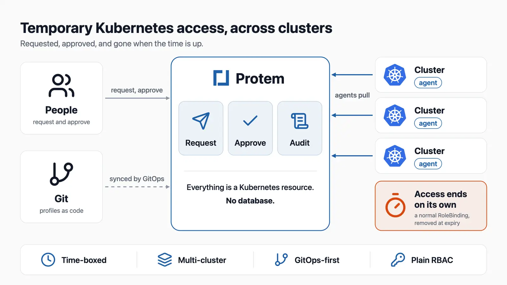

# How it works

The parts of Protem and the path one request takes, from the profile that allows it to the moment its binding is removed from a target cluster.

Protem has to answer one question for every elevation: why can a role granted by a hub on one cluster be relied on to disappear from another cluster on time, even if the two lose contact? The answer is in how the work is split between the parts, and in which part decides what.

## The parts

- **The hub** is one Kubernetes cluster. It stores every profile, request, grant and target cluster as a custom resource; there is no database. The operator runs there as one process with several controllers, and also serves the web UI and the REST API behind it.
- **An agent** runs for each target cluster (the code is in `cmd/enforcer` and `internal/enforcer`). It reads only its own cluster's grants from the hub and creates ordinary RoleBindings and ClusterRoleBindings on its own cluster.
- **Git** is where profiles and target clusters usually live. A GitOps tool such as Argo CD or Flux applies them to the hub. The UI shows objects a GitOps tool manages as read-only, and edits the others only when the operator runs with `--ui-management=enabled`.
- **People** reach the UI through a login proxy and an OIDC identity provider. Requests can also be created with `kubectl` directly on the hub.

What each resource is, field by field, is in [Concepts](concepts.md). This page follows them in motion.

## One request, from profile to removed binding

### The profile decides what can be asked for

An AccessProfile names one role, the clusters it can be granted on (by name or by label selector), the namespaces, the longest duration, who may request it, and the approval rules that decide, per cluster, whether approval is automatic or manual and who approves. Nothing can be requested that a profile does not describe.

### The request freezes its scope

When someone creates an AccessRequest, the operator's request controller checks it against the profile: may this person request it, does the ticket match the pattern, is a reason given, are the targeted clusters Ready, does the person already hold or wait for the same access. If it passes, the controller resolves the role, scope, clusters, namespaces and duration and writes them into the request's status. From then on the request carries its own copy. Editing the profile later does not change what an already-sent request grants, and the approvers see exactly what will be granted.

The approval rules are resolved per cluster at the same moment, into one requirement for each cluster. If every requirement is automatic, the request is approved at once; otherwise it waits for enough approvals from the people each requirement names. [Request and grant lifecycle](request-lifecycle.md) follows these phases in detail.

### Approval produces a grant

Once a request is approved, the request controller creates one AccessGrant. Its expiry is the time of approval plus the frozen duration, so time spent waiting for approvers does not shorten the access. The grant is owned by the request.

### The grant fans out into cluster grants

The grant controller writes one ClusterGrant for each target cluster into that cluster's own namespace on the hub, `protem-cluster-<name>`. A ClusterGrant carries only what that one cluster needs: the role, scope, namespaces, the subject to bind (the RBAC user name, from `--subject-template` or the TargetCluster's own `subject` field), the expiry, and a revocation if there is one. The reason and ticket stay in the request on the hub.

If the hub itself is one of the targeted clusters (it is named `local` unless `--hub-cluster-name` says otherwise), the operator creates the bindings on the hub directly.

### The agent pulls and binds

Each agent lists the ClusterGrants in its own namespace on the hub every `--sync-interval` (3 seconds by default). For each grant that has neither expired nor been revoked, it checks that the role exists on its cluster and creates the RoleBindings or ClusterRoleBindings for it. Each binding is labelled with the grant it belongs to and annotated with its expiry. The agent writes the result back to the ClusterGrant's status (`Active`, or `Failed` with the error), and the grant on the hub collects those states per cluster.

The agent can create a binding only for a role that the cluster's owner has put on the agent's ceiling list; the cluster's own API server refuses anything else. Why the hub never connects to the cluster, and why the ceiling sits on the cluster's side, is explained in [Hub and agents](hub-and-agents.md).

### The binding is removed at expiry, by the agent

Every 5 seconds, separately from the sync, the agent looks at the bindings it manages on its own cluster and deletes every one whose expiry has passed, or whose expiry it cannot read. It does not ask the hub first. This is why access ends on time even when the hub is unreachable: the expiry travelled with the binding.

On the hub, the grant controller marks the grant `Expired` and deletes its ClusterGrants. The next sync on the agent removes any binding whose ClusterGrant is gone, so the two paths agree.

A revocation takes the other route. It is a change on the hub: the grant gets a revocation, the grant controller copies it into each ClusterGrant, and each agent removes the bindings on its next sync and reports `Revoked`. It reaches a cluster only when that cluster's agent can read the hub.

## What each part decides

| Decision | Made by | Where it is enforced |
|---|---|---|
| What can be requested, and who approves it | whoever can write AccessProfiles on the hub | request controller, when the request is validated |
| Whether this request is approved | the approvers each requirement names, or the profile's automatic rule | request controller |
| Which roles can ever be bound on a cluster | that cluster's owner | the target cluster's API server |
| When a binding ends | the frozen duration, stamped on the binding | the agent's local timer |
| Whether a binding ends early | the requester, or someone allowed to update the grant on the hub | the agent, on its next successful sync |

The [security model](security-model.md) builds on this split: what each party can and cannot do, and what Protem does not protect against.
