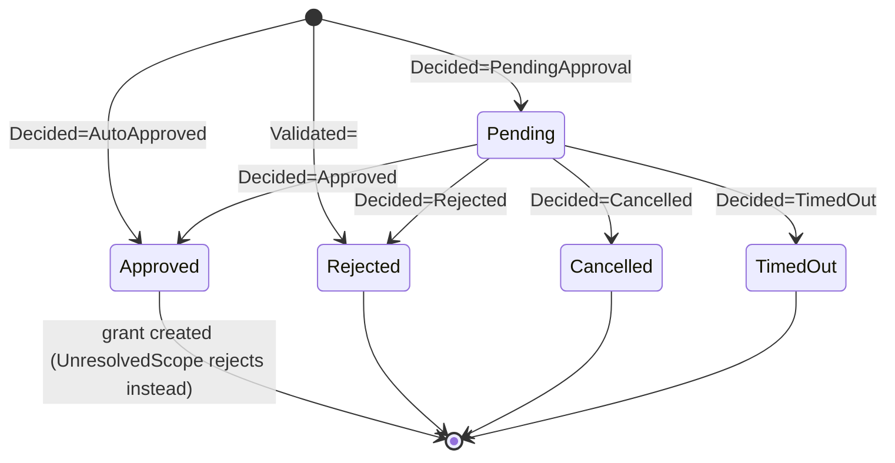
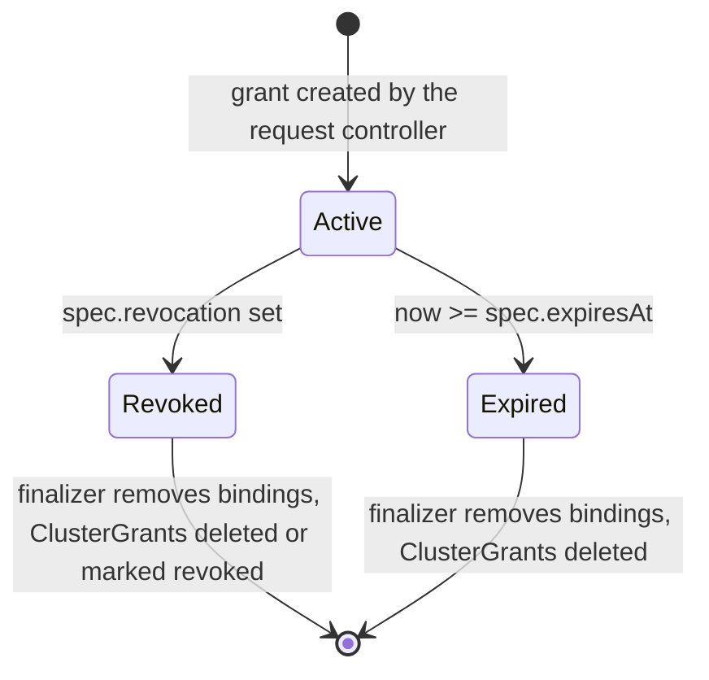

# Request and grant lifecycle

Why an AccessRequest or AccessGrant sits in the phase it does, and what moves it to the next one.

The phases are computed, not chosen: every transition below follows directly from `Advance` in `internal/controller/accessrequest_lifecycle.go` and from the reconcile loop in `internal/controller/accessgrant_controller.go`. This page explains the state machine; it does not walk through creating a request or a profile — see [How it works](how-it-works.md) for the path a request takes, and the [guides](../guides/how-to-connect-a-target-cluster.md) for the how-to pages.

## AccessRequest

A request with no phase yet is validated against the profile it names, then either rejected at once, auto-approved, or left `Pending` for review.

Validation checks, in order, before a scope is ever frozen: the profile must exist (`ProfileNotFound`), the requester must be named by the profile (`UnauthorizedRequester`), a required ticket must match the profile's pattern (`InvalidTicket`), a required justification reason must be present (`MissingJustification`), every targeted cluster must be ready or wait for it (`ClusterNotReady`, below), the cluster and namespace resolution must succeed (`ResolutionFailed`), and the requester must not already hold or be waiting on the same access (`AlreadyHeld`). Any of these ends the request `Rejected` with that reason on its `Validated` condition; none of them can be retried by waiting.

Once validation passes, the resolved role, scope, clusters, namespaces, duration and the per-cluster approval requirements are written into the request's status and never change again — editing the profile afterwards has no effect on a request already past this point. With that scope frozen, a request whose resolved clusters are all auto-approved becomes `Approved` immediately (`Decided=AutoApproved`); otherwise it becomes `Pending` (`Decided=PendingApproval`) and waits for approvals.

### A targeted cluster that is not ready

Resolving clusters can fail because a cluster the profile targets exists but is not `Ready` — the hub just started, or its agent is reconnecting (see [Hub and agents](hub-and-agents.md) for what `Ready` means). Rather than reject immediately, the controller gives it up to `readyGrace` (one minute), re-checking every 5 seconds. If a targeted cluster becomes ready inside that window, validation continues normally. If the grace period passes and the cluster is still not ready, the request is rejected with `Validated=ClusterNotReady`.

### Review and timeout

While `Pending`, the request is re-evaluated against the approval decisions recorded on it: a cancellation by the requester ends it `Cancelled`; a rejection by any eligible approver ends it `Rejected`; enough approvals for every resolved cluster's requirement ends it `Approved` (`Decided=Approved`). Independently of decisions, if the profile's `approval.pendingTimeout` is set and that much time has passed since the request was created, it ends `TimedOut` (`Decided=TimedOut`) regardless of any partial approvals already recorded. A profile with no `pendingTimeout` leaves a request `Pending` indefinitely until an approver or the requester acts.

### Issuing the grant

An `Approved` request with no grant yet is issued: its frozen role, scope and duration must all be present, or it is rejected instead with `Decided=UnresolvedScope` — this can only happen if the request's status was corrupted or edited outside the normal flow, since validation always sets all three together. Otherwise, one AccessGrant is created with `ExpiresAt` set to the time the request was decided (not the time it is issued), plus the frozen duration, so time spent waiting for approval never shortens the access.

## AccessGrant

A grant has no `Pending` phase: it reconciles straight into `Active`, and only ever leaves it for `Revoked` or `Expired`.

Revocation always wins over expiry: the controller checks `spec.revocation` first. Reaching either terminal phase removes the bindings the grant owns directly (on the hub, if the hub is itself a targeted cluster) and either deletes or marks revoked the ClusterGrant in each target cluster's namespace — from there, each cluster's own agent removes the matching bindings on its next sync. The `protem.dev/finalizer` on the grant guarantees this cleanup runs even if the grant object itself is deleted before it naturally expires.

While `Active`, the grant also carries a per-cluster `status.clusters[].state` (`Pending`, `Active`, `Revoked`, `Failed`) mirrored from each ClusterGrant's own status — this is how a request shows, per cluster, whether the agent has actually applied the binding or failed to (for example `RoleNotFound`, if the role the profile names does not exist on that cluster).
