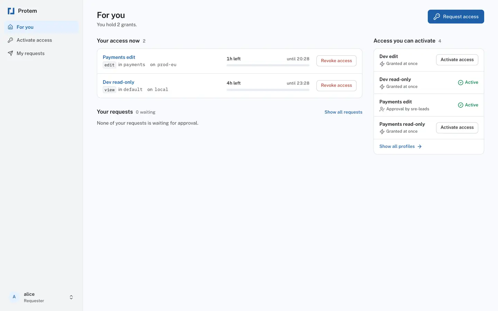
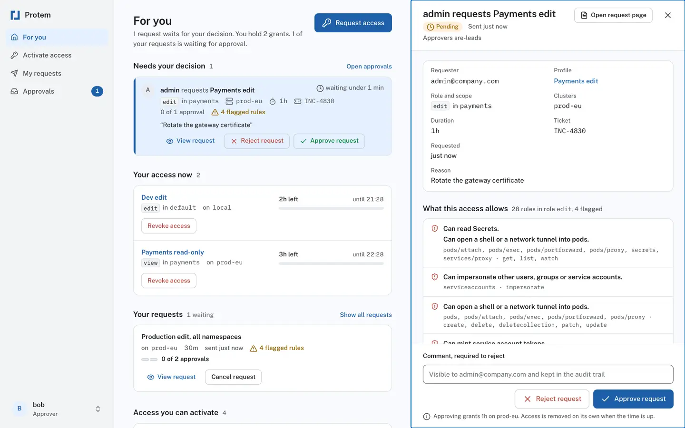

# Getting started: your first request

In this tutorial you install Protem's custom resources into a cluster you are admin on, start the operator with built-in test users, request a self-service grant and watch it become a `RoleBinding`, then request a grant that needs approval, approve it as a different person, revoke a grant, and watch one expire on its own.

You need: Go 1.26+, `kubectl`, and a Kubernetes cluster as your current context (kind and k3d both work) where you are cluster-admin. Nothing here needs a real identity provider or a second cluster.

## 1. Clone the repository and install the CRDs

```sh
git clone https://github.com/iLLeniumStudios/protem.git
cd protem
make install
```

This applies the five custom resource definitions Protem adds — `TargetCluster`, `AccessProfile`, `AccessRequest`, `AccessGrant`, `ClusterGrant` — described in [Concepts](../architecture/concepts.md). It ends with five `customresourcedefinition.apiextensions.k8s.io/... created` lines.

## 2. Make the test admin a hub admin

```sh
kubectl apply -f hack/dev-personas-rbac.yaml
```

This binds the built-in `admin@company.com` test persona to a ClusterRole that can manage profiles, clusters, requests and grants. Without it `--dev-auth`'s test personas are plain users with no hub-admin rights.

## 3. Register the hub as a cluster

Protem always needs at least one `TargetCluster`: the cluster the operator runs on. Save this as `hub-cluster.yaml`:

```yaml
apiVersion: protem.dev/v1alpha1
kind: TargetCluster
metadata:
  name: local
  labels:
    env: dev
spec:
  displayName: Hub cluster
```

This is the resource [Concepts](../architecture/concepts.md#targetcluster) describes: a cluster Protem can grant access on. `metadata.name` must match the operator's `--hub-cluster-name` flag, which defaults to `local`.

```sh
kubectl apply -f hub-cluster.yaml
```

## 4. Create two profiles

An `AccessProfile` is what can be requested. Save this as `profiles.yaml` — one profile granted at once, one that needs an approver:

```yaml
apiVersion: protem.dev/v1alpha1
kind: AccessProfile
metadata:
  name: read-default
  namespace: default
spec:
  displayName: Read the default namespace
  role:
    kind: ClusterRole
    name: view
  scope: Namespaced
  namespaces: [default]
  clusters:
    names: [local]
  duration:
    default: 1h
    max: 4h
  requesters:
    groups: [devs]
  justification:
    reason: Required
  approval:
    rules:
    - name: self-service
      mode: Auto
---
apiVersion: protem.dev/v1alpha1
kind: AccessProfile
metadata:
  name: edit-default
  namespace: default
spec:
  displayName: Edit the default namespace
  role:
    kind: ClusterRole
    name: edit
  scope: Namespaced
  namespaces: [default]
  clusters:
    names: [local]
  duration:
    default: 2m
    max: 1h
  requesters:
    groups: [devs]
  justification:
    reason: Required
  approval:
    pendingTimeout: 1h
    rules:
    - name: sre-leads-approve
      mode: Manual
      approvers:
        groups: [sre-leads]
      requiredApprovals: 1
```

`read-default`'s one approval rule is `mode: Auto`, so any matching request is granted at once. `edit-default`'s rule is `mode: Manual` and needs one approval from the `sre-leads` group — its default duration is two minutes, short enough to watch it expire later in this tutorial. [Concepts](../architecture/concepts.md#accessprofile) explains the rest of the fields.

```sh
kubectl apply -f profiles.yaml
```

## 5. Start the operator

```sh
go run ./cmd/main.go --dev-auth --api-bind-address=127.0.0.1:8080
```

**Note:** this tutorial's commands use port 8080, the operator's default. If something on your machine already uses it, add `--api-bind-address=127.0.0.1:<a free port>` and open that port instead.

`--dev-auth` replaces login with built-in test personas (`alice@company.com`, a requester; `bob@company.com`, an approver in `sre-leads`; `admin@company.com`, made a hub admin in step 2) chosen from the UI instead of a real identity provider. Leave this running; open a new terminal for the rest of the tutorial, or run it in the background.

Within a few seconds `kubectl get targetclusters` shows `local` as `Ready`, because the hub is always its own `TargetCluster` and needs no agent:

```console
$ kubectl get targetclusters
NAME    DISPLAY NAME   PHASE   AGENT VERSION   ACTIVE GRANTS   LAST HEARTBEAT
local   Hub cluster    Ready
```

## 6. Request the self-service profile

Open <http://127.0.0.1:8080> in a browser. The account menu at the bottom left is already set to Alice, a requester. On the For you page, under "Access you can activate", choose **Activate access** for "Read the default namespace".



Fill in a reason (for example "Look at the pods in default") and choose **Request access**. Because the profile's rule is `Auto`, the request shows **Approved** immediately, with a link to the grant it produced.

Confirm the grant and the binding it created:

```console
$ kubectl get accessrequests,accessgrants -n default
NAME                                      PROFILE        REQUESTER           PHASE      DURATION   GRANT
accessrequest.protem.dev/req-...          read-default   alice@company.com   Approved   1h0m0s     grant-req-...

NAME                                        PROFILE        REQUESTER           ROLE   PHASE    EXPIRES AT
accessgrant.protem.dev/grant-req-...        read-default   alice@company.com   view   Active   2026-11-24T21:53:55Z

$ kubectl get rolebindings -n default -l protem.dev/managed-by=protem
NAME                                       ROLE               AGE
protem-grant-default.grant-req-...         ClusterRole/view   6s

$ kubectl auth can-i list pods -n default --as alice@company.com
yes
```

The grant and the binding both carry the role your profile named, and `kubectl auth can-i` proves the access is real, not just a status field.

## 7. Request the profile that needs approval

Back in the UI, open **Activate access** and choose **Request approval** for "Edit the default namespace". Give it a reason (for example "Restart the web deployment") and submit. This time the request's phase is **Pending**, and it lists what the role allows, flagging the risky rules (reading Secrets, opening a shell in pods) first.

## 8. Approve it as the approver

Open the account menu and switch to **Bob, approver**. The sidebar now shows "Approvals, 1 waiting". Open Approvals, open Alice's request, and choose **Approve request**.



The request moves to **Approved** and a second `AccessGrant` and `RoleBinding` appear, the same way as in step 6:

```console
$ kubectl get accessgrants -n default
NAME                            PROFILE        REQUESTER           ROLE   PHASE    EXPIRES AT
grant-req-...-z68cb             read-default   alice@company.com   view   Active   2026-11-24T21:53:55Z
grant-req-...-27g8n             edit-default   alice@company.com   edit   Active   2026-11-24T20:56:41Z
```

## 9. Revoke the first grant

Switch the account menu back to **Alice, requester** and open For you. You now hold two grants. Choose **Revoke access** on "Read the default namespace", give a reason, and confirm.

```console
$ kubectl get accessgrants -n default
NAME                   PROFILE        REQUESTER           ROLE   PHASE     EXPIRES AT
grant-req-...-z68cb    read-default   alice@company.com   view   Revoked   2026-11-24T21:53:55Z
grant-req-...-27g8n    edit-default   alice@company.com   edit   Active    2026-11-24T20:56:41Z

$ kubectl get rolebindings -n default -l protem.dev/managed-by=protem
NAME                        ROLE               AGE
protem-grant-...-27g8n      ClusterRole/edit   27s
```

The `view` binding is gone and `kubectl auth can-i list pods -n default --as alice@company.com` now answers `no` for that role, while the `edit` grant from step 8 is still active.

## 10. Watch the remaining grant expire

The `edit-default` profile's duration is two minutes, which has likely already passed. Within a few seconds of its `expiresAt` time:

```console
$ kubectl get accessgrants -n default
NAME                   PROFILE        REQUESTER           ROLE   PHASE     EXPIRES AT
grant-req-...-z68cb    read-default   alice@company.com   view   Revoked   2026-11-24T21:53:55Z
grant-req-...-27g8n    edit-default   alice@company.com   edit   Expired   2026-11-24T20:56:41Z

$ kubectl get rolebindings -n default -l protem.dev/managed-by=protem
No resources found in default namespace.

$ kubectl auth can-i list pods -n default --as alice@company.com
no
```

Nobody revoked it: the grant's own expiry time ended it, and both grants from this tutorial have now left no binding behind.

## Where to go next

- [Concepts](../architecture/concepts.md) explains every resource you just created.
- [How to check who had access](../guides/how-to-check-who-had-access.md) shows the same two requests on the Audit page.
- [How to install the hub with Helm](../guides/how-to-install-with-helm.md) moves from this local trial to a real deployment.
