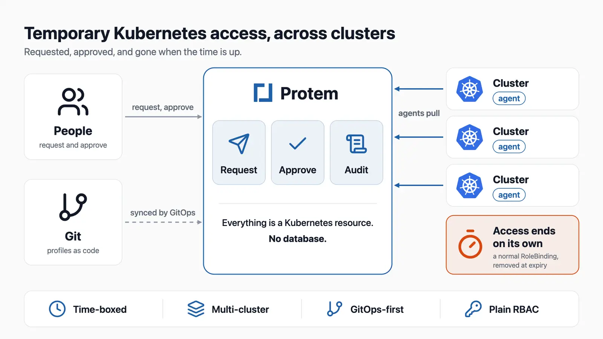

# Overview

What Protem is, who it is for, and when to use it.

Protem is a Kubernetes operator with a web UI that grants temporary Kubernetes roles. Someone requests a role for a few hours, an approver decides (or the profile grants it at once), and the access is removed on its own when the time is up. A hub cluster holds the rules and the requests as custom resources; an agent on each target cluster turns an approved request into an ordinary `RoleBinding` and removes it when it expires.

## The problem it removes

Standing privileged access — someone holding `cluster-admin` or `edit` on a production cluster for months because they needed it once — is a liability that outlives the reason for it. The usual alternatives are a shared process nobody follows (a ticket, then a manual `kubectl apply` that nobody remembers to revert) or a broker that proxies and records every `kubectl` session. Protem does neither: it grants exactly the role a profile allows, for exactly as long as it says, as plain Kubernetes RBAC, and takes it away again without anyone having to remember.

## Who it is for

Teams running more than one Kubernetes cluster who want a paper trail and a time limit on elevated access, without replacing RBAC with something else. It assumes the reader already knows Kubernetes RBAC — Roles, ClusterRoles, RoleBindings — and wants a system that requests, approves and expires them.

## When not to use it

Protem is not a replacement for everyday RBAC: most people should hold the access their job needs, continuously, through ordinary RBAC. It is not a session broker — it does not proxy, record or replay `kubectl` sessions, and it cannot end a `kubectl exec` or port-forward that is already open. Use it for the exceptions: incident response and rare elevated tasks, not for the access someone needs every day.

## Status

**Note:** Protem is alpha software. Its API is `v1alpha1` and may change, it has had no independent security review, and it has only been run on kind and k3d, not on a managed Kubernetes service or in production. Decide for yourself whether that is acceptable for your use before relying on it.

## Where to go next

- [Getting started: your first request](getting-started/first-request.md) — a tutorial from a clone of the repository to a granted, approved and expired request.
- [Concepts](architecture/concepts.md) — the five resources Protem adds and how they relate.
- [How to install the hub with Helm](guides/how-to-install-with-helm.md) — installing on a real cluster.
- [Architecture: how it works](architecture/how-it-works.md) — the components and the path of one request.
